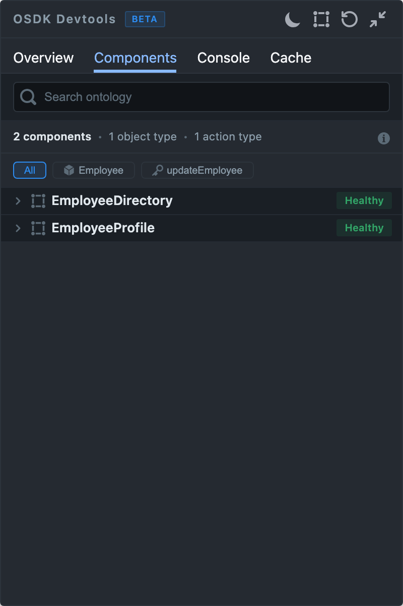

The Components tab maps `@osdk/react` hooks to the React components that mounted them. Use it to find the component that owns a query, compare components that read the same object type, or trace an overfetching recommendation back to its source.

## What appears

Only components that call an `@osdk/react` hook, such as `useOsdkObject` or `useOsdkObjects`, appear. A component that only renders an OSDK-aware child like `ObjectTable`, or receives objects through props, does not appear; look for the child that owns the hook instead. Data loaded with raw network calls or another state library is not tracked.

Component attribution relies on the Fiber hook that the Vite plugin installs before React loads. If the panel shows a **DevTools Hook Not Installed** notice, see [Troubleshooting](./index.mdx#troubleshooting).

## Find a component

- **Search ontology** matches component names, object types, primary keys, actions, and property names.
- The summary line counts mounted components, object types, and action types.
- The filter chips narrow the list to one object type or action. Select **All** to clear the filter.

## Component cards

Each card groups what the monitor observed for one component:

| Section | Contents |
| --- | --- |
| Related objects | Object types the component's hooks load, with the primary keys of instances whose properties were read. |
| Related actions | Actions the component binds with `useOsdkAction`. |
| Related properties | Properties read on objects the component's hooks returned, by the component or by children it passed them to. |
| React props | Props captured from the mounted component. |

## Health badge

A card shows **Healthy** unless the monitor detects a problem. After a component has rendered more than five times, the monitor flags:

- Wasted renders: renders in which the component read no tracked property.
- Properties read fewer times than 10% of the component's render count.

An unhealthy card replaces the badge with a summary such as `3 wasted · over-fetch 2`.
