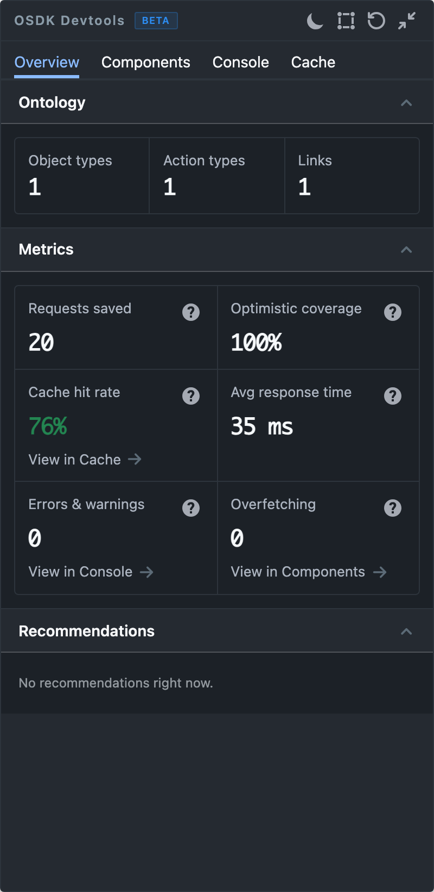

{/* cspell:ignore revalidations */}

The Overview tab is the first tab the panel shows. It summarizes how the mounted components use the Ontology and how the client has performed since the page loaded or since you last selected **Reset metrics**.

## Ontology

Counts the distinct object types, action types, and links that mounted components use. If no component uses the Ontology yet, the section says so and links to these docs.

## Metrics

| Metric | What it measures | Highlighted when |
| --- | --- | --- |
| Requests saved | Reads served from the cache, revalidations, and deduplicated requests that did not reach the network. | Never |
| Optimistic coverage | Share of actions that updated the UI before the server responded. See [Optimistic updates](../optimistic-updates.mdx). | Never |
| Cache hit rate | Share of object reads, including revalidations, served from the cache. Shows `N/A` until the session has 20 reads. | Green above 70%, amber above 40% up to 70%, red at 40% or below |
| Avg response time | Average response time across cache and network reads. Cache reads typically take under 1 ms, so network reads dominate. | Never |
| Errors & warnings | `console.error` and `console.warn` entries captured this session. | Red when above 0 |
| Overfetching | Mounted `@osdk/react` hooks whose fetched fields are mostly unread. A hook counts when less than 70% of its fetched fields are read. | Red when above 0 |

Optimistic coverage shows `N/A` until 3 actions have run, and Avg response time until 5 reads.

Select the help icon on a metric for its definition and thresholds. Three metrics link to the tab with the detail behind them:

| Metric | Link | Opens |
| --- | --- | --- |
| Cache hit rate | **View in Cache** | [Cache](./cache.mdx) |
| Errors & warnings | **View in Console** | [Console](./console.mdx) |
| Overfetching | **View in Components** | [Components](./components.mdx) |

## Recommendations

Recommendations turn the metrics and component observations into specific fixes, such as a query that fetches unused fields. Each has a **Copy fix prompt** button that copies a prompt you can paste into a coding assistant, and a **Dismiss** button. **Copy all** copies the prompts for every recommendation. With nothing to suggest, the section reads `No recommendations right now.`

## Measure one flow

1. Select **Reset metrics** in the panel header. This clears Requests saved, Optimistic coverage, Cache hit rate, Avg response time, and Cache history, without touching app data or the cache. To also zero Errors & warnings, select **Clear logs** on the Console tab. Dismiss recommendations you have already handled.
2. Run the flow you want to measure in your app.
3. Read the metrics for that flow. Overfetching and Ontology always reflect the components mounted now.
