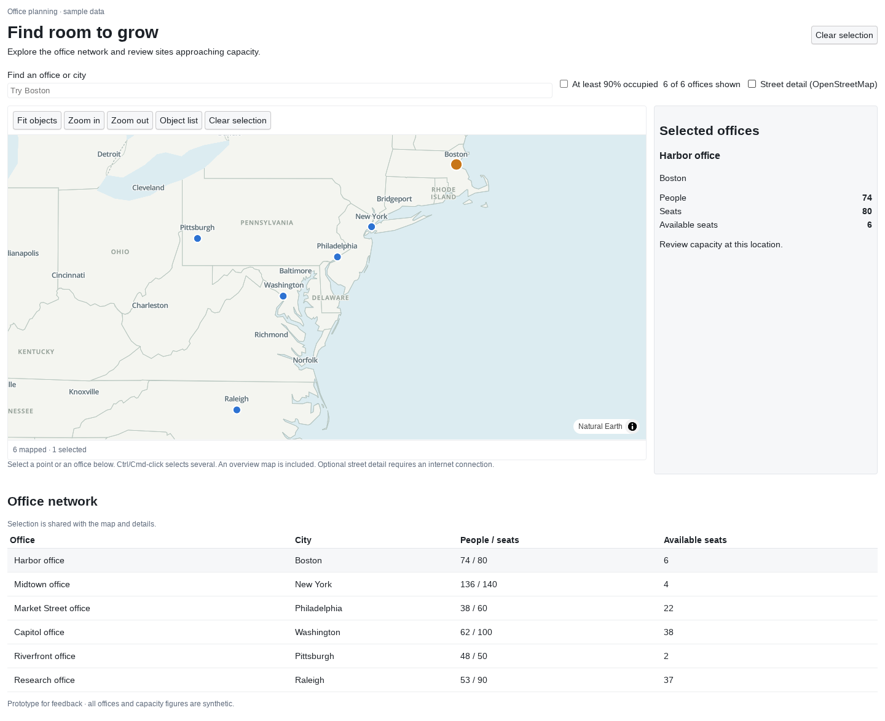

# ObjectMap

An experimental ontology-aware map for reviewing object locations alongside tables and detail panels. It loads a paginated object set through `@osdk/react`, renders geopoint and geoshape properties, and exposes selection as ordinary React state.

This draft targets small, interactive workflows. It renders loaded geometry in the browser; it does not yet use Map Rendering Service (MRS), ontology renderer sets, custom rendering functions, or vector tiles. Its API may change before promotion to a stable entry point.

## Installation and setup

Install the optional map renderer when using this entry point:

```sh
pnpm add maplibre-gl
```

Follow the package [provider and CSS setup](../README.md#setup). The map entry point includes MapLibre's control styles:

```tsx
import "@osdk/react-components/styles.css";
import { ObjectMap } from "@osdk/react-components/experimental/object-map";
```

The OSDK component requires an `OsdkProvider` with a configured client. The lower-level `BaseObjectMap` works with plain geometry and does not require a provider. Maps require browser WebGL support and a container with a height.

## Minimal usage

```tsx
import { ObjectMap } from "@osdk/react-components/experimental/object-map";
import { Office } from "@my/osdk";

<div style={{ height: "60vh" }}>
  <ObjectMap objectType={Office} />
</div>;
```

The component selects the geometry property automatically when the type has exactly one geopoint or geoshape property. If there are several, specify `geometryProperty="location"`. Missing or invalid geometry is omitted and counted in the map's status.

No external basemap is requested by default. Points and shapes appear on a blank background. To provide geographic context, pass a MapLibre style object or URL through `mapStyle`; the application chooses the tile provider, attribution, credentials, and allowed origins. A custom-widget deployment must allow its style, tile, sprite, glyph, and worker resources through its Content Security Policy.

## Compose a map with application state

Use one object set and one selection state for all views:

```tsx
import type { Osdk } from "@osdk/api";
import { useOsdkClient } from "@osdk/react";
import { ObjectMap } from "@osdk/react-components/experimental/object-map";
import { ObjectTable } from "@osdk/react-components/object-table";
import { useMemo, useState } from "react";

import { Office } from "@my/osdk";

const EMPTY_SELECTION: readonly Osdk.Instance<Office, "$allBaseProperties">[] =
  [];

function OfficeExplorer() {
  const client = useOsdkClient();
  const offices = useMemo(() => client(Office), [client]);
  const [selected, setSelected] = useState(EMPTY_SELECTION);
  const keys = useMemo(
    () => selected.map((office) => office.$primaryKey),
    [selected],
  );

  return (
    <>
      <div style={{ height: "50vh" }}>
        <ObjectMap
          objectType={Office}
          objectSet={offices}
          geometryProperty="location"
          selectedObjectKeys={keys}
          onSelectionChanged={setSelected}
        />
      </div>
      <div style={{ height: "35vh" }}>
        <ObjectTable
          objectType={Office}
          objectSet={offices}
          selectionMode="multiple"
          selectedRows={keys}
          onRowSelectionChanged={(change) => setSelected(change.selectedRows)}
        />
      </div>
    </>
  );
}
```

`filter` applies a server-side where clause, including when `objectSet` is provided. The map shares the application's OSDK client and observable object cache. The wrapper does not make independent REST requests.

Selection is uncontrolled by default. Supply `defaultSelectedObjectKeys` to seed it, or `selectedObjectKeys` plus `onSelectionChanged` to control it. The callback returns selected **loaded** object instances. The map displays only the pages it has loaded; a table can have additional loaded rows or objects with no geometry. Such objects cannot be shown as map features.

## Prototype applications



### Without Foundry credentials

From the repository root:

```sh
pnpm install
pnpm --filter @osdk/react-components transpileAllDeps
pnpm turbo transpileBrowser --filter='@osdk/react-components-storybook^...'
pnpm --filter @osdk/react-components-storybook dev
```

Open [Office planning prototype](http://localhost:6006/?path=/story/components-objectmap--application-prototype), or open the [standalone canvas](http://localhost:6006/iframe.html?id=components-objectmap--application-prototype&viewMode=story) to demo the application without Storybook's sidebar.

The prototype uses synthetic offices and capacity figures. It requires no Foundry login and makes no external tile requests by default. The optional **Street basemap** control loads OpenStreetMap tiles for geographic context. It demonstrates a real map renderer and shared React state; its fixture data is not a test of live ontology fetching.

Try this review script:

1. Select **Harbor office** from the office list. The map selection and detail panel follow.
2. Select another map point, then Ctrl/Cmd-click to select several offices.
3. Enable **At least 90% occupied** to narrow the office network.
4. Search for **Boston**. The list and map show the same filtered subset.
5. Clear the search and use **Fit objects** to frame the visible locations.

Other stories exercise geometry types, loading with existing data, errors, empty results, and pagination indicators.

The application prototype opens with all six offices and leaves its controls to the viewer. Its automated interaction checks run in a separate test-only story.

For a remote workspace, forward port **6006**. Storybook serves both the page and its live-reload WebSocket on that port. After changing the Storybook server configuration, restart the dev server and reload the page.

Map tiles are off initially. Enable **Street basemap** to request streets and place names from OpenStreetMap. These requests come from the viewer's browser, so that browser must be able to reach the tile provider. The object markers and list remain usable without external tiles.

### With a live ontology

Use the existing [peopleapp sandbox](../../e2e.sandbox.peopleapp/README.md). Configure `.env.local` from its sample and generate the SDK for an ontology containing the sandbox's `Office` type if needed. Then run:

```sh
pnpm --filter @osdk/e2e.sandbox.peopleapp transpileAllDeps
pnpm --filter @osdk/e2e.sandbox.peopleapp dev
```

Open **Office Map** in the navigation, or visit `/office-map`. The map and `ObjectTable` use the same OSDK object set. Applying the office-name prefix filter affects both views, and selection updates the read-only office details. This path uses real data and the configured user's permissions.

The live example has not been made available through a public hosted deployment by this package; developers run it against their own configured Foundry environment.

## Scope and feedback

The initial component supports one object type, one geometry property, paged loading, pan/zoom, fit-to-data, selection, and loading/error/empty states. It keeps rendered features visible during refresh. Additional pages are requested explicitly through **Load more**, rather than implying that the visible points represent the entire object set. Interface types are not supported in this draft.

Areas to evaluate before expanding the API:

- Does linking filters, map selection, and a table solve the intended workflow?
- Is the default interaction clear with both mouse and keyboard?
- Which workflows need several independently styled layers?
- Which datasets need MRS-backed rendering instead of loading geometry into the browser?

MRS integration is a follow-up for consistent ontology styling, renderer-set defaults, custom renderers, and scalable vector tiles. Drawing, clustering, temporal playback, live map subscriptions, Workshop embedding/ejection, and offline tile packaging are also outside this draft. The example runs as ordinary React; it does not implement an editor or an ejection pipeline.

## Props

### ObjectMapProps

<!-- AUTOGEN:props START src=src/object-map/ObjectMapApi.ts interface=ObjectMapProps — generated by scripts/gen-props.mjs; run `pnpm --filter @osdk/react-components gen-props` -->

Type parameters: `Q extends ObjectTypeDefinition`

| Name                        | Type                                                                   | Description                                                                                                                       |
| --------------------------- | ---------------------------------------------------------------------- | --------------------------------------------------------------------------------------------------------------------------------- |
| `ariaLabel`                 | `string`                                                               | Accessible name of the map. Defaults to `"Object map"`.                                                                           |
| `mapStyle`                  | `string \| StyleSpecification`                                         | Map style or style URL. No external tile requests are made by default. Defaults to `a blank basemap`.                             |
| `defaultViewport`           | `MapViewport`                                                          | Uncontrolled initial camera. Defaults to `center [0, 20], zoom 1`.                                                                |
| `onViewportChanged`         | `(viewport: MapViewport) => void`                                      | Observes camera changes after map navigation. Defaults to `undefined`.                                                            |
| `className`                 | `string`                                                               | Additional root class. The parent must provide a height. Defaults to `undefined`.                                                 |
| `objectType`                | `Q`                                                                    | **Required.** Object type to display. Interface types are not supported.                                                          |
| `objectSet`                 | `ObjectSet<Q>`                                                         | Object set to display instead of all objects of the type. Defaults to `undefined`.                                                |
| `filter`                    | `WhereClause<Q>`                                                       | Server-side filter, also applied when an object set is supplied. Defaults to `undefined`.                                         |
| `geometryProperty`          | `PropertyKeys<Q>`                                                      | Geometry property. Required when the type has multiple geometry properties. Defaults to `the sole geopoint or geoshape property`. |
| `pageSize`                  | `number`                                                               | Number of objects requested per page. A Load more button exposes additional pages. Defaults to `100`.                             |
| `selectedObjectKeys`        | `readonly PrimaryKeyType<Q>[]`                                         | Controlled selection by primary key. Omit to let the map own selection. Defaults to `undefined`.                                  |
| `defaultSelectedObjectKeys` | `readonly PrimaryKeyType<Q>[]`                                         | Uncontrolled initial selection by primary key. Defaults to `[]`.                                                                  |
| `onSelectionChanged`        | `(objects: readonly Osdk.Instance<Q, "$allBaseProperties">[]) => void` | Observes selected loaded objects in either selection mode. Defaults to `undefined`.                                               |

<!-- AUTOGEN:props END -->

### BaseObjectMapProps

<!-- AUTOGEN:props START src=src/object-map/BaseObjectMapApi.ts interface=BaseObjectMapProps — generated by scripts/gen-props.mjs; run `pnpm --filter @osdk/react-components gen-props` -->

| Name                 | Type                               | Description                                                                                             |
| -------------------- | ---------------------------------- | ------------------------------------------------------------------------------------------------------- |
| `features`           | `readonly MapFeature[]`            | **Required.** Features to display. Each feature must have a unique ID.                                  |
| `ariaLabel`          | `string`                           | Accessible name of the map. Defaults to `"Object map"`.                                                 |
| `mapStyle`           | `string \| StyleSpecification`     | Map style or style URL. No external tile requests are made by default. Defaults to `a blank basemap`.   |
| `defaultViewport`    | `MapViewport`                      | Uncontrolled initial camera. Defaults to `center [0, 20], zoom 1`.                                      |
| `selectedIds`        | `readonly string[]`                | Controlled selection. Omit to let the map own selection. Defaults to `undefined`.                       |
| `defaultSelectedIds` | `readonly string[]`                | Uncontrolled initial selection. Defaults to `[]`.                                                       |
| `onSelectionChanged` | `(ids: readonly string[]) => void` | Observes selection in either mode. Ctrl/Cmd-click toggles individual features. Defaults to `undefined`. |
| `onViewportChanged`  | `(viewport: MapViewport) => void`  | Observes camera changes after map navigation. Defaults to `undefined`.                                  |
| `isLoading`          | `boolean`                          | Show a loading indicator while retaining visible features. Defaults to `false`.                         |
| `error`              | `Error`                            | A loading error to display alongside existing features. Defaults to `undefined`.                        |
| `onRetry`            | `() => void`                       | Retry a failed data request. Defaults to `undefined`.                                                   |
| `hasMore`            | `boolean`                          | Whether more objects can be requested. The map shows only loaded features. Defaults to `false`.         |
| `onLoadMore`         | `() => void`                       | Requests the next page of objects. Defaults to `undefined`.                                             |
| `omittedObjectCount` | `number`                           | Number of loaded objects without valid geometry. Defaults to `0`.                                       |
| `className`          | `string`                           | Additional root class. The parent must provide a height. Defaults to `undefined`.                       |

<!-- AUTOGEN:props END -->

## Styling

Map controls and geometry colors use the package's design tokens. See [CSS variables](./CSSVariables.md#object-map) for the `--osdk-map-*` tokens. Custom `mapStyle` content is styled by the supplied MapLibre style.
